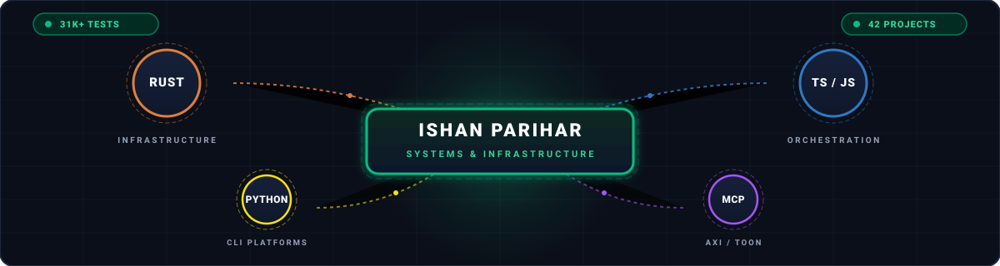

I build and operate production agentic infrastructure: MCP servers, agent runtimes, compilers and protocol layers, in Rust, TypeScript, Python and Go. Every figure on this page is measured from the repositories it describes, and each carries the command and the date that produced it.

  

<b>Agentic AI Systems Engineer &amp; Operator</b> · Production Agentic Infrastructure · AI-Augmented Architecture · Multi-Agent Orchestration

 🌐 [ishanparihar.com](https://ishanparihar.com) · 🔗 [LinkedIn](https://www.linkedin.com/in/ishan-parihar/) · 📍 Noida, India · ✈️ Remote: worldwide · 📧 [Get in touch](mailto:contact@ishanparihar.com)

<b>Every claim below carries a commit, and every number is re-measured.</b> Start with <a href="#hire-me--or-verify-the-code-yourself-first">Hire Me</a>, or read the <a href="#complete-project-catalog-56-ranked-projects--1-struck--6-web-sites">full catalog</a> and check the code yourself first.

## Contents

- [📊 Engineering by the Numbers](#engineering-by-the-numbers)
- [🎯 Value Proposition — Proof, Not Promises](#value-proposition--proof-not-promises)
  - [💼 Hire Me — or verify the code yourself first](#hire-me--or-verify-the-code-yourself-first)
- [⚙️ Core Paradigm: How I Operate](#core-paradigm-how-i-operate)
- [💎 Flagship Projects](#flagship-projects)
- [🛠️ The Complete Ecosystem](#the-complete-ecosystem)
- [🔬 Unified Tech Stack Matrix](#unified-tech-stack-matrix)
- [📂 Complete Project Catalog (56 Ranked Projects + 1 Struck + 6 Web Sites)](#complete-project-catalog-56-ranked-projects--1-struck--6-web-sites)
- [🧭 The Arc: Space → Mind → Infrastructure](#the-arc-space--mind--infrastructure)
- [📄 Documentation](#documentation)
- [☕ Sponsor this work](#sponsor-this-work)

<!-- 2026-11-02: Rust/TypeScript/Python badges removed — the doorway rubric's
BADGE_CEILING is 7 and the page carried 8; those three duplicated the stack matrix. -->

## 📊 Engineering by the Numbers

I design and implement custom cognitive substrates, low-overhead tools, and high-throughput communication routing layers. The operational scope of this portfolio covers:

| Metric | Value | Technical Context & Evidence |
|--------|-------|------------------------------|
| **MCP Servers** | **17** | 1,190 registered MCP tools across 17 MCP-exposing repos (`portfolio-measurements.json`, measured 2026-11-06, re-derived by `genome close`) |
| **Rust Crates** | **95** | 95 `Cargo.toml` manifests across the 75 published repos (65 federation + 10 catalog) — vendored, generated and documentation trees excluded (`portfolio-measurements.json`, measured 2026-11-06, re-derived by `genome close`) |
| **Lines of Code** | **3.46M** | ≈3.46M first-party source lines (Rust, TypeScript, Python, Go, Svelte, QML, shell) across the 75 published repos (65 federation + 10 catalog) (`portfolio-measurements.json`, measured 2026-11-06, re-derived by `genome close`) |
| **Automated Tests** | **≈31,400 markers** | ≈31,400 test markers across 59 of 75 repos; 16 report none because their language has no marker rule here. Markers are NOT passing cases — gate results are recorded separately with their commit (`portfolio-measurements.json`, measured 2026-11-06, re-derived by `genome close`) |
| **Context Reduction** | **40–60%** | Token savings verified via custom Token-Oriented Object Notation (TOON) compiler — benchmark claim, not an engine attribute |
| **Production Runtime** | **<10MB** | Stripped static musl Rust binaries with minimal idle RSS, zero dynamic dependencies — benchmark claim, not an engine attribute |

> All metrics are machine-measured from the repositories — no self-reported numbers.
> Performance claims (context reduction, runtime footprint) are benchmark-verified on the linked flagships.

## 🎯 Value Proposition — Proof, Not Promises

I'm an **Agentic AI Systems Engineer & Operator** — I direct AI-augmented builds of the graph engines, compilers, and protocol layers that make autonomous AI agents functional, resilient, and cost-effective under real production loads. **Substrates are chosen per project (Rust, TypeScript, Python, Go, Kotlin) — never as identity.** Outcomes over protocols; operator, not coder. **Every flagship below points to the proof living in its own repository** — playable demos, runnable test suites, and measured benchmarks. Open the repo and verify it yourself.

What that means in measured terms, ranked by the evidence a recruiter can actually open and re-run — the full order is computed by `scripts/rank_score.py` (rubric: 30% architecture, 25% tests, 20% agent surface, 15% scale, 10% utility, re-derived 2026-11-02), not chosen by hand. All six are public and their gates re-run:

| # | Project | Score | The measured proof behind the claim |
|---|---|---|---|
| 1 | **[operant](https://github.com/ishan-parihar/operant)** | `9.40` | 7,163 passed / 3 failed / 14 ignored across 71 binaries at `ca33d4c` (2026-10-20 `cargo test --workspace`) — the highest-test-count runtime in the portfolio |
| 2 | **[switchpost](https://github.com/ishan-parihar/switchpost)** | `9.26` | 1,031 passed / 19 failed across 72 binaries (`cargo test --workspace` at `2104084`, 2026-11-06), 162K LOC across 25 platforms, 389 MCP tools in 44 modules, 3 releases |
| 3 | **[mysterium](https://github.com/ishan-parihar/mysterium)** | `8.87` | 2,110 of 2,112 cases passing across 188 test files (`vitest run` at HEAD, 2026-10-28), 64-cell developmental matrix |
| 4 | **[openscript](https://github.com/ishan-parihar/openscript)** | `8.70` | 113 MCP tools, 158 passing / 1 failing, agent-directed brief-to-render pipeline |
| 5 | **[tdg-rust](https://github.com/ishan-parihar/tdg-rust)** | `8.46` | 626 passed / 0 failed at `44e7f9b` (2026-10-20), zero warnings, 50 MCP tools, 10 releases |
| 6 | **[holon](https://github.com/ishan-parihar/holon)** | `8.10` | 57K-LOC, 56-command MIT-licensed agent OS — self-healing organization of persistent AI employees, 10 measured sophistication families |

Those six carry **12,494 measured test cases** between them, each naming its own command and date in [docs/FLAGSHIPS.md](docs/FLAGSHIPS.md): 7,163 operant + 1,031 switchpost + 2,110 mysterium + 546 openscript + 626 tdg-rust + 1,018 holon (every figure is passed cases at the named commit; three of operant's 71 binaries, 19 of switchpost's 72 and one of openscript's 20 were red that day, and holon had one failure in 1,018). The portfolio totals **3.46M first-party LOC** and **≈31,400 test markers** across 75 published repos (see [📊 Engineering by the Numbers](#engineering-by-the-numbers)). Two private repos score above parts of this table — **[sourcehound](https://github.com/ishan-parihar/sourcehound)** (`9.43`) and **[c-suite-agents](https://github.com/ishan-parihar/c-suite-agents)** (`8.36`, gate red at 76/8/8 of 95) — and a reader cannot re-run either gate today, so both stay in the [catalog](#complete-project-catalog-56-ranked-projects--1-struck--6-web-sites), locked and capped at B. The claim is not "I can build agents" — it is "I can build agent systems whose behaviour I can prove at a commit, and hand you the proof to re-run."

---

### 💼 Hire Me — or verify the code yourself first

For founding / forward-deployed engagements, agentic-systems architecture, or fractional CTO work for AI-first teams — [📧 Get in touch](mailto:contact@ishanparihar.com). I ship production agentic infrastructure end-to-end via AI-augmented architecture; substrates chosen for the project, not the team. Or audit the code first: start from the portfolio's highest-test-count runtime ([Operant](https://github.com/ishan-parihar/operant), 7,163 Rust tests passing at `ca33d4c`, 2026-10-20 gate) or the compact fully-verified engine ([TDG Rust](https://github.com/ishan-parihar/tdg-rust), 626 tests).

## ⚙️ Core Paradigm: How I Operate

I treat AI system design as **spatial machinery** rather than linear text prompting, and I direct its construction via **AI-augmented architecture** — systems thinking first, substrates chosen per project, the agent runtime writing the implementation under operator supervision. Most agent frameworks today are fragile prompt wrappers. I deliver **load-bearing substrates**:
* **Operator-led, AI-augmented builds**: I architect the system, set the test discipline, choose the substrate (Rust/TypeScript/Python/Go/Kotlin), and direct the build. The **≈31,400 test markers** across 75 published repos (`portfolio-measurements.json`, measured 2026-11-06) are the audit trail of that method — not the result of typing each line by hand. Markers are counted, not claimed as passing: every tier row below states its own measured pass/fail at its own HEAD and date.
* **Graph-Native Orchestration**: I replace linear shell scripts and standard pipelines with property graphs. Every execution node has typed ports; the engine resolves dependencies, materializes parallel branches via a Tokio level scheduler, and exposes the live execution DAG to LLM operators over MCP.
* **Token-Efficient Serialization**: I designed and compiled the TOON (Token-Oriented Object Notation) standard. Eliminating structural syntax redundancy cuts context-window footprint 40–60% versus JSON, with deterministic validation preserved.
* **Minimal Memory footprint**: I compile zero-dependency static musl Rust binaries; the intelligence-gathering pipeline curates 411 sources across 47 countries inside a ~7MB static file at <5MB idle RAM.
* **Systems Diagnostics**: Background in architectural design, spatial diagnostics, and cognitive modeling — I translate systemic risk, organizational constraints, and multi-agent topologies into deterministic software constraints.

## 💎 Flagship Projects

The ten flagship systems, one line each, in the order `scripts/rank_score.py` computes — **full write-ups with their measured proof live in [docs/FLAGSHIPS.md](docs/FLAGSHIPS.md).**

| Flagship | What it does | Measured proof | Where the proof lives |
|---|---|---|---|
| 🔒 📡 **[sourcehound](https://github.com/ishan-parihar/sourcehound)** | Intelligence ingestion across 411 sources in 47 countries — **private today** (link 404s for visitors; capped at B-tier, re-publication planned) | ~7MB static binary, ~5MB idle RSS, 9 custom parsers | the feeds it emits, natively in TOON |
| 🤖 **[operant](https://github.com/ishan-parihar/operant)** | Terminal-native ReAct agent runtime — 60+ tools, hybrid memory, channels | 7,163 passed / 3 failed / 14 ignored across 71 binaries at `ca33d4c` (`cargo test --workspace`, 2026-10-20) | `./scripts/install.sh` + `operant setup && operant chat` — runnable in three commands |
| 🌐 **[switchpost](https://github.com/ishan-parihar/switchpost)** | Multi-platform content engine across 25 platforms | 162K LOC, 389 MCP tools across 44 tool modules, 3 releases, 1,031 tests across 72 binaries at `2104084` | the axum REST surface + `rmcp` MCP server on one binary |
| 🧠 **[mysterium](https://github.com/ishan-parihar/mysterium)** | Education-system replacement — 64-cell developmental matrix, 9-command CLI | 2,110 of 2,112 cases passing (`vitest run` at HEAD, 2026-10-28), 139K LOC | the 9-command CLI (`setup`, `status`, `new-game`, `diagnostic`, …) driven from the shell |
| 🎬 **[openscript](https://github.com/ishan-parihar/openscript)** | Agent-directed video pipeline — brief → script → TTS → render | 113 MCP tools, 158 passing / 1 failing (`cargo test` at HEAD, 2026-10-28) | `docs/` renders produced end-to-end through MCP tool calls |
| 🧠 **[tdg-rust](https://github.com/ishan-parihar/tdg-rust)** | Teleological memory graph — every memory a `(Content, Embedding, Telos)` node | 626 tests / 0 failed at `44e7f9b` (`cargo test`, 2026-10-20), 50 MCP tools | the repo's "Testing" section: `cargo test` = 626 passing (449 lib + 68 MCP e2e + 44 plugin + integration + property suites) |
| 💼 **[linkedin-lyr](https://github.com/ishan-parihar/linkedin-lyr)** | Professional profile extraction + Voyager profile-edit surface | 55K LOC, 25 CLI commands + 25 MCP tools, 2 releases | a 25-command agent-first CLI with TOON output and AXI 6/6 ergonomics |
| 🧠 **[mindstrata](https://github.com/ishan-parihar/mindstrata)** | Deterministic emergent society simulation — every agent a complete mind | 155K LOC, 307 passing / 3 failing (`cargo test` at HEAD, 2026-10-28) | `cargo test` — history always emerges from locally bounded agents |
| 📊 **[deckmill](https://github.com/ishan-parihar/deckmill)** | Browserless carousel factory — 38 of 46 slide types renderable | 192 tests green at `5003ecb`, 36K LOC, 20 MCP tools | `docs/previews/` — 6 slides actually rendered by the embedded Blitz engine, no browser, no screenshots |
| 🎵 **[scorestrata](https://github.com/ishan-parihar/scorestrata)** | Contract-first music compiler — brief → mastered WAV | 944 tests green at `a9cb251` (`cargo test --workspace`, 2026-11-06), 73K LOC | the repo's "Hear it" section: two rendered demo tracks (LP nu-metal, nu-disco) with spectrogram showcases + `ss render` to regenerate |

---

### 🔒 📡 [sourcehound](https://github.com/ishan-parihar/sourcehound)

**Intelligence Gathering System — High-performance Rust engine.** ~7MB static binary, ~5MB RSS, 143 MCP tools.

> **🔒 Private today** — its link 404s for visitors and its gate cannot be re-run by a reader; capped at B until it is public again. Kept in the portfolio because re-publication is planned; the figures below are from its last public revision, not live claims.

A lightweight news and data ingestion pipeline scraping 411 distinct sources across 47 countries. It filters, deduplicates, and enriches global national, tech, and financial news, generating optimized intelligence feeds for agent consumption.

* **Serialization**: Outputs natively in TOON, saving 40% to 60% in downstream context window costs.
* **Parsers**: 9 custom-engineered stream parsers handling RSS, Atom, HTML tables, OFAC lists, and PDF archives.
* **Efficiency**: Developed to replace a slow, high-memory Node.js prototype, dropping idle RAM consumption to under 5MB.

### 🤖 [operant](https://github.com/ishan-parihar/operant)

**Terminal-native ReAct agent runtime.** Rust. Tests: 7,163 passed, 3 failed, 14 ignored across 71 binaries at `ca33d4c` (2026-10-20, `cargo test --workspace`; the suite is active, so treat the figure as that day's gate, not a current count). MCP client + server, skills, messaging channels.

A production-grade agent runtime written in Rust that runs from your shell: a real think → act → observe loop with a JSON-schema tool registry, memory-context injection every turn, provider fallbacks, and self-healing retries.

* **Memory**: `agentmemory` hybrid semantic memory (BM25 + vector + graph), auto-spawned on first use; optional Postgres backend.
* **Tools**: 60+ JSON-schema tools — fs, git, web, CDP browser, shell, code, http, memory, skills, cron, kanban, notes, checkpoints.
* **Channels**: Telegram · Discord · Slack · WhatsApp via the gateway; WASM plugins; `operant autonomous` dev loop.
* **Local-first**: no telemetry, no account; any OpenAI-compatible endpoint or a local llama.cpp / Ollama model.

### 🌐 [switchpost](https://github.com/ishan-parihar/switchpost)

**Multi-network content ops engine.** Rust + SvelteKit. 1,031 passed / 19 failed across 72 binaries (`cargo test --workspace` at `2104084`, 2026-11-06; the 19 are 3 OAuth red-team assertions plus credential-gated live transport tests), 162K LOC, 389 MCP tools across 44 modules, 3 releases.

One binary exposing three interfaces over the same engine: a CLI for shell and agent use, a REST API with a real-time dashboard, and an MCP server for Claude, Cursor and Codex.

* **Surface**: 389 MCP tools across 44 tool modules, plus a 127-endpoint REST API.
* **Platforms**: 25 content platforms behind one authenticated interface.
* **Gate**: build the SvelteKit frontend first (`frontend/build/` must exist for the `RustEmbed` derive), then `cargo test --workspace`.

### 🧠 [mysterium](https://github.com/ishan-parihar/mysterium)

**Education-system replacement — holonic developmental matrix.** TS + Python. 139K LOC, 2,110 of 2,112 cases passing (measured `vitest run` at HEAD, 2026-10-28).

A structured cognitive curriculum engine: a 64-cell developmental matrix with a holonic growth model, plus a **9-command agent-first CLI** (`setup`, `status`, `new-game`, `diagnostic`, `curriculum`, `session`, `glossary`, `profile`, `setup-profile`) — an AXI-style surface agents drive directly from the shell.

* **Matrix**: 64-cell developmental grid; curriculum, session, and profile state machines over it.
* **Surface**: `mysterium` bin globally installable; deterministic, non-interactive commands.
* **Skills**: ships structured skill libraries (workspace-lint, ui-ux-pro-max, ui-styling) as reusable agent tooling.

### 🎬 [openscript](https://github.com/ishan-parihar/openscript)

**Agent-directed video editing pipeline.** Rust + TypeScript. 113 MCP tools, 546 passing with 1 failing across 20 binaries (measured `cargo test --workspace` at `d9a1924` on a clean export, 2026-11-06; the failure is `tools::tests::test_library_search_keyword_query`).

A full agent-native media pipeline: take a brief, generate a script, synthesize voices, cut a timeline, and render — driven end-to-end through MCP tools rather than a GUI.

* **Pipeline**: brief → script → TTS → vision → FFmpeg → Remotion render, orchestrated as MCP tool calls.
* **Depth**: 12/12 measured sophistication families (state machines, DSLs, protocols, storage, determinism, plugins…) across 5 languages.
* **Surface**: 113 MCP tools — the widest tool surface in the portfolio after switchpost.

### 🧠 [tdg-rust](https://github.com/ishan-parihar/tdg-rust)

**Teleological Developmental Graph — Pure Rust cognitive engine.** 626 tests (`cargo test`, 626 passed / 0 failed, measured 2026-10-20 at `44e7f9b`; ledger row 40). 50 MCP tools.

A complex implementation of stateful agent memory using a holonic graph structure. Every memory unit is represented as a node: `(Content, Embedding, Telos)`. The teleological decay algorithm ensures stale or irrelevant context decays over time while highly relevant goal nodes remain active.

* **Interface**: 50 custom MCP tools allowing agents to write, link, prune, and query memories using vector search combined with graph traversal.
* **Validation**: 626 tests total — zero warnings, zero regressions, verified against the current suite (626 passed / 0 failed at `44e7f9b`, 2026-10-20; ledger row 40).
* **Canonical**: The Rust port supersedes the original Python reference (now private); `tdg-rust` is the single canonical TDG project.

### 💼 [linkedin-lyr](https://github.com/ishan-parihar/linkedin-lyr)

**Professional profile extraction + Voyager profile-edit surface.** Python. 55K LOC, 1,400 tests passing, 32 skipped (measured `uv run pytest` at `c629a39`, 2026-11-06), 25 MCP tools, 2 releases.

A full LinkedIn integration with a **25-command agent-first CLI** and the most complete AXI ergonomics in the portfolio (6/6 axi.md signals). Every interaction is machine-parseable: TOON structured output, a `--full` escape hatch from content truncation, definitive empty states, size-hinted truncation, pre-computed `total_count` aggregates, and structured exit codes.

* **AXI 6/6**: the only portfolio repo implementing every axi.md principle end-to-end.
* **Surface**: 25 CLI commands and 25 MCP tools; profile fetch, search, and edit flows agents drive deterministically.

### 🧠 [mindstrata](https://github.com/ishan-parihar/mindstrata)

**Deterministic emergent human-society simulation — every agent a complete mind.** Rust. 155K LOC, 1,258 passing with 3 failing across 12 binaries (measured `cargo test --workspace` at `6834297`, 2026-11-06; the 3 are one simulation-cell crate, the rest of the workspace is green).

Not just a "society sim": a full cognitive-science stack — bodies, nervous systems, appraisal-based emotion, belief systems, social bonds, institutions, culture, and noospheric fields. Three architecture plans (AP1 → AP2 → AP3) deepen it from a medieval settlement into a multi-scale civilization simulation where history always emerges from locally bounded agents.

---
### 📊 [deckmill](https://github.com/ishan-parihar/deckmill)

**Browserless carousel factory.** Rust. 192 passed / 0 failed (`cargo test --workspace` at `5003ecb`, 2026-11-06), 36K LOC, 20 MCP tools, 7 releases.

A slide renderer that needs no browser and no screenshots: an embedded Blitz engine draws the slides directly, so the output is a real file a reader can open rather than a claim about one.

* **Coverage**: 38 of 46 slide types renderable (verified 2026-10-27).
* **Proof**: `docs/previews/` holds 6 slides actually rendered by the embedded engine.

### 🎵 [scorestrata](https://github.com/ishan-parihar/scorestrata)

**Contract-first music compiler — from plain-language brief to mastered WAV.** Rust. 12 crates, 944 passed / 0 failed (`cargo test --workspace` at `a9cb251`, 2026-11-06), 73K LOC.

A deterministic composition compiler that turns a human brief into a full-length WAV: event-sourced composition state, a validator gate with genre/register/layer checks, a production-grade layered synth, and a mastering chain. Same brief → byte-identical audio, every run.

* **Pipeline**: Brief → plan → compile → validate → render → master.
* **Audio**: Production-grade layered synth voices (SF2-sampled drums, doubled guitar, organics) with per-layer spectral auditing.
* **Determinism**: Byte-identical replay from contract + seed; the same 944 tests enforce no-regression rules.

## 🛠️ The Complete Ecosystem

The operational landscape of these systems, grouped by what they expose. Every row is ranked by the same rubric as the software catalog below, so a tool listed here carries

the score it earned rather than a description alone.

### Unified MCP & Agent Infrastructure

| System | Stack | Surface | Description |
|--------|-------|---------|-------------|
| **[sourcehound](https://github.com/ishan-parihar/sourcehound)** | Rust | 143 Tools | Lightweight intelligence aggregator scraping 411 sources in 47 countries |
| **[switchpost](https://github.com/ishan-parihar/switchpost)** | Rust | 389 MCP Tools + REST | Multi-network content ops engine (25 platforms, JWT auth, SSE realtime) |
| **[openscript](https://github.com/ishan-parihar/openscript)** | Rust/TS | 113 Tools | AI-directed video editing pipeline (TTS, FFmpeg, Remotion) |
| **[artificial-route](https://github.com/ishan-parihar/artificial-route)** | Rust | OpenAI + 276 providers | Minimal-RAM LLM gateway — one endpoint over the full catalog, 19 routing strategies, static musl binary |
| **[tdg-rust](https://github.com/ishan-parihar/tdg-rust)** | Rust | 50 Tools | Teleological developmental graph memory and knowledge synthesizer |
| 🔒 **[c-suite-agents](https://github.com/ishan-parihar/c-suite-agents)** | TypeScript | 72 Tools | Multi-agent daemon + LifeOS MCP server — **private; its gate is red** (76/8/8 of 95, `bun test` at HEAD 2026-10-28) → link 404s, capped at B, not production-grade |
| **[holon](https://github.com/ishan-parihar/holon)** | Python | 56 Commands | Harness-agnostic agentic OS that runs as an organization of persistent AI employees |
| **[memory-wire](https://github.com/ishan-parihar/memory-wire)** | Rust | 54 MCP Tools + REST | Agent memory in one static binary — retain/recall/reflect, bank isolation, FTS5 BM25 + RRF fusion, PII redaction |
| **[metatrader-bridge](https://github.com/ishan-parihar/metatrader-bridge)** | Python/MQL5 | 91 Tools | MetaTrader 5 ↔ MCP bridge — regime detection, ATR position sizing, bracket orders, trailing stops |
| **[deckmill](https://github.com/ishan-parihar/deckmill)** | Rust | 20 Tools | Browserless carousel factory — 38 of 46 slide types renderable (verified 2026-10-27), embedded Blitz renderer |
| **[cloakctl](https://github.com/ishan-parihar/cloakctl)** | Python | 25 Commands | One persistent stealth browser per profile over CLI verbs, plus a registry of reusable agent automations |
| **[andrometry](https://github.com/ishan-parihar/andrometry)** | Kotlin/Go | 59 Tools | Personal context engine: Kotlin Android collector with a Go MCP server |
| **[browsefleet](https://github.com/ishan-parihar/browsefleet)** | Node/TS | 28 REST Endpoints | Stealth browser fleet: leased CDP contexts, sessions/screenshots/PDFs for agents |
| **[automaton](https://github.com/ishan-parihar/automaton)** | Rust | 38 Tools | Graph-native build, plan, and scheduled execution engine |
| **[thinking-steroid](https://github.com/ishan-parihar/thinking-steroid)** | TypeScript | 13 Tools | Forced epistemic cognitive modes (first-principles, polarity mapping, etc.) |
| **[lifeos-bot](https://github.com/ishan-parihar/lifeos-bot)** | Python | Telegram MCP | LifeOS conversational interface — activity/diet/journal/financial logging |
| **[lifeos-ops](https://github.com/ishan-parihar/lifeos-ops)** | Rust | 31 Tools | Unified CLI + MCP server for Notion-based LifeOS |
| **[hermes-prime-bridge](https://github.com/ishan-parihar/hermes-prime-bridge)** | Python | 3 Tools | Live plugin importing Prime Agent's persistent kernel into Hermes's stateless runtime |

### Agent-Native Platform CLIs (`-lyr` Family) & Obscura

One shared AXI-compliant architecture: every tool speaks TOON/YAML output, structured errors, and contextual help; `obscura-core` is the shared cookie-vault daemon underneath the browser-scraping family.

| Tool | Stack | Surface | Description |
|------|-------|---------|-------------|
| **[linkedin-lyr](https://github.com/ishan-parihar/linkedin-lyr)** | Python | 25 Tools + 25 Commands | Professional profile extraction and company intelligence scraping |
| **[instagram-lyr](https://github.com/ishan-parihar/instagram-lyr)** | Python | 47 Tools | Stealth profile reconnaissance and HTTPX-based media scraper |
| **[twitter-lyr](https://github.com/ishan-parihar/twitter-lyr)** | Python | 45 Commands | Agent-native X/Twitter integration handling DMs, media, and search |
| **[facebook-lyr](https://github.com/ishan-parihar/facebook-lyr)** | Python | 41 Tools | Facebook / Messenger MCP server via cookie-based scraping |
| **[tg-lyr](https://github.com/ishan-parihar/tg-lyr)** | Python | 36 Commands | Fast Telethon-powered Telegram messaging automation client |
| **[amazon-lyr](https://github.com/ishan-parihar/amazon-lyr)** | Python | 21 Tools | The full Amazon lifecycle as MCP tools — search, cart, orders, shipments, no API keys |
| **[etmoney-lyr](https://github.com/ishan-parihar/etmoney-lyr)** | Python | 10 Tools | ET Money research layer — 67 mutual-fund categories and stock screens as MCP tools |
| **[reddit-lyr](https://github.com/ishan-parihar/reddit-lyr)** | Python | 56 Tools | Dense Reddit scraping, analysis, and interaction CLI |
| **[discord-lyr](https://github.com/ishan-parihar/discord-lyr)** | Python | 16 Commands | Local-first Discord data CLI (SQLite sync, search, analytics) |
| **[swiggy-lyr](https://github.com/ishan-parihar/swiggy-lyr)** | Python | 20 MCP Tools | Unified Swiggy MCP — Food, Instamart and Dineout in one server, one OAuth token |
| **[threads-lyr](https://github.com/ishan-parihar/threads-lyr)** | Python | 3 Tools | Threads.net MCP server via anonymous scraping |
| **[meme-lyr](https://github.com/ishan-parihar/meme-lyr)** | TypeScript | 6 Commands | AXI-compliant structured image overlay and meme generator |
| **[obscura-core](https://github.com/ishan-parihar/obscura-core)** | Python | 8 REST Endpoints | Stealth browser integration: cookie vault + CDP daemon powering the lyr family |

### Developer Tooling & Infrastructure — tools the agent-facing work is built *with*; none exposes an agent surface

| Tool | Stack | Surface | Description |
|------|-------|---------|-------------|
| **[android-webcam](https://github.com/ishan-parihar/android-webcam)** | Kotlin/QML | 1 Command | Android phone as webcam and microphone on the Linux desktop — 720p/1080p, front/back, torch |
| **[AI-CAD](https://github.com/ishan-parihar/AI-CAD)** | TS/Python | 23 Endpoints | AI-powered CAD platform — FastAPI floor-plan generation, ezdxf DXF export, real-time collaboration |
| **[palimpsest](https://github.com/ishan-parihar/palimpsest)** | TS/Python | Library | A training system for one mind — the AI is the trainer, the digestion happens in the reader |
| **[project-genome](https://github.com/ishan-parihar/project-genome)** | Python | 11 Commands | A project's knowledge genome — owned document roles, mutability classes, and a stdlib CLI (`wake`/`ask`/`close`) — the tool that gates this portfolio's own documentation |
| **[linux-telemetry](https://github.com/ishan-parihar/linux-telemetry)** | Python | 12 Commands | Production-grade Linux usage telemetry — window activity, browser history, process launches |
| **[n8n-compiler](https://github.com/ishan-parihar/n8n-compiler)** | Python | 10 Commands | Treat n8n workflows as code |
| **[metatrader-docker-deployment](https://github.com/ishan-parihar/metatrader-docker-deployment)** | Python/MQL5 | 5 Commands | Production MetaTrader 4 & 5 Docker deployment with noVNC browser access |
| **[pill-bar](https://github.com/ishan-parihar/pill-bar)** | QML/JS | Plugin | Omarchy segmented pill bar + static tray. `pill-bar` is the superset plugin (31 files): `segmented-pill-bar` (27), `pill-suite` (29) and `static-tray` (3) ship the same QML widget set with fewer pieces, and all four are listed individually in the catalog below |
| **[omarchy-vpn](https://github.com/ishan-parihar/omarchy-vpn)** | QML | Plugin | Omarchy bar plugin for a self-hosted VPS VPN — WireGuard full-tunnel + SSH SOCKS fallback, live stats, IPv6-leak guard |

### Portfolios & Web User Interfaces (Separate Category — not tiered)

| Platform | Tech Stack | Architecture & Operational Details |
|----------|------------|-----------------------------------|
| 🔒 **[ishanparihar-svelte](https://github.com/ishan-parihar/ishanparihar-svelte)** | SvelteKit 5 / Supabase | Core platform with Razorpay integrations, authentication, MDX CMS |
| 🔒 **[law-of-one-india-website](https://github.com/ishan-parihar/law-of-one-india-website)** | Next.js 15 / Postgres | Community publishing hub with custom caching, role-based auth, MDX |
| 🔒 **[design-aesthetics-website](https://github.com/ishan-parihar/design-aesthetics-website)** | SvelteKit / Tailwind | Architectural portfolio: 49K LOC, GSAP, WebGL shaders, Three.js |
| 🔒 **[lifeos-website](https://github.com/ishan-parihar/lifeos-website)** | Next.js 15 / Tailwind | Platform documentation hub and production marketing page |
| 🔒 **[webdev-portfolio](https://github.com/ishan-parihar/webdev-portfolio)** | Next.js / TypeScript | Freelance portfolio scaffold — agent prompt + design system; site source lives in the nested `my-portfolio` repo |
| 🔒 **[ishanparihar-cms](https://github.com/ishan-parihar/ishanparihar-cms)** | TypeScript | Web backend exposing 60+ CMS tools for content management |

## 🔬 Unified Tech Stack Matrix

- **Languages**: Rust, TypeScript, Python, Kotlin, Go, SQL, Zig, Bash, MQL5
- **Protocols**: Model Context Protocol (MCP), Agent eXperience Interface (AXI), TOON Serialization
- **Infrastructure**: Docker, systemd services, PostgreSQL, SQLite, Supabase, LanceDB, n8n automation
- **AI/ML Integration**: local LLMs (llama.cpp, Qwen), OpenAI, Anthropic, Gemini, Whisper, Whisper Hinglish
## 📂 Complete Project Catalog (56 Ranked Projects + 1 Struck + 6 Web Sites)

<b>🚀 S-TIER: Flagship Systems — Score ≥ 8.0 — 2 capped by policy (2 private), shown at the score they earned (11 Projects)</b>

* 🔒 **[sourcehound](https://github.com/ishan-parihar/sourcehound)** `9.43` (private): High-speed news ingestion pipeline — 11 sophistication families, 143 MCP tools, 28 releases, 411 sources in 47 countries.
* **[operant](https://github.com/ishan-parihar/operant)** `9.40`: Terminal-native ReAct agent runtime — 560K LOC, 7,163 tests passing with 3 failing across 71 binaries at `ca33d4c` (2026-10-20 gate; the suite is active), 7 workspace crates (re-measured 2026-11-01: `Cargo.toml` `members = [api, os, config, core, cli, plugins, harness]`, 10 manifests in total — an earlier "19 crates" here counted vendored and nested manifests and is corrected), 12/12 sophistication families (state machines, DSLs, storage, determinism, plugins…).
* **[switchpost](https://github.com/ishan-parihar/switchpost)** `9.26`: 162K LOC across 25 platforms (registry-verified), 10 sophistication families, 389 MCP tools across 44 tool modules, 3 releases, 1,031 passed / 19 failed across 72 binaries at `2104084` (2026-11-06).
* **[mysterium](https://github.com/ishan-parihar/mysterium)** `8.87`: Education-system replacement — 64-cell developmental matrix, holonic curriculum, 2,110 of 2,112 cases passing across 188 test files (measured `vitest run` at HEAD after `svelte-kit sync`, 2026-10-28), 10 sophistication families, 9-command AXI-first CLI (5/6 signals).
* **[openscript](https://github.com/ishan-parihar/openscript)** `8.70`: Agent-directed video editing pipeline — 113 MCP tools, 546 passing with 1 failing across 20 binaries (measured `cargo test --workspace` at `d9a1924` on a clean export, 2026-11-06), 12/12 sophistication families, 5 languages.
* **[artificial-route](https://github.com/ishan-parihar/artificial-route)** `8.52`: Minimal-RAM Rust LLM gateway — one OpenAI-compatible endpoint over 276 providers, 19 routing strategies, auto/*, static musl binary. 26 releases, Apache-2.0. Reaches S-tier on ITS OWN measured architecture score (8.6/10), not on a claim.
* **[tdg-rust](https://github.com/ishan-parihar/tdg-rust)** `8.46`: Teleological developmental graph memory — 626 tests (626 passed / 0 failed at `44e7f9b`, 2026-10-20), 50 MCP tools, 11 sophistication families, 10 releases.
* **[linkedin-lyr](https://github.com/ishan-parihar/linkedin-lyr)** `8.44`: Professional profile extraction + Voyager profile-edit surface. 1,400 tests passing, 32 skipped (measured `uv run pytest` at `c629a39`, 2026-11-06), 25 CLI commands + 25 MCP tools, 2 releases, 9 sophistication families, 6/6 axi.md signals.
* 🔒 **[c-suite-agents](https://github.com/ishan-parihar/c-suite-agents)** `8.36` (private): Multi-agent daemon + bundled LifeOS MCP server (35 tools, LanceDB/SQLite + Telegram). 76 passing, 8 failing, 8 errors of 95 cases (measured `bun test` at HEAD, 2026-10-28 — its own gate is red), 10 sophistication families.
* **[holon](https://github.com/ishan-parihar/holon)** `8.10`: Harness-agnostic agentic OS that runs as a self-healing, self-evolving organization of persistent AI employees. 57K LOC, MIT, 10 measured sophistication families. Enters at S-tier (8.10) on the same rubric as every other engine here.
* **[memory-wire](https://github.com/ishan-parihar/memory-wire)** `8.08`: Agent memory in one static Rust binary — retain/recall/reflect with bank isolation, FTS5 BM25 + RRF fusion, PII redaction on write, over HTTP or as an MCP stdio server. 14 releases.

<b>🧠 A-TIER: Production-Grade Engines — Score 6.5–7.99 — 2 capped by policy (1 experimental, 1 private), shown at the score they earned (18 Projects)</b>

* 🔒 **[kali-mahabali](https://github.com/ishan-parihar/kali-mahabali)** `7.88` (private): Modular intelligence framework — Codename Chimera. Interchangeable modules (reasoning, memory, tools, models) snapping into a central spine. 63K LOC (Rails engine), CI build, MIT license. Experimental.
* **[mindstrata](https://github.com/ishan-parihar/mindstrata)** `7.82`: Deterministic emergent society simulation — 13 crates, 155K LOC, 1,258 passing with 3 failing across 12 binaries (measured `cargo test --workspace` at `6834297`, 2026-11-06), 10 measured sophistication families (state machines, graphs/holonics, DSLs, determinism, plugins…).
* **[metatrader-bridge](https://github.com/ishan-parihar/metatrader-bridge)** `7.67`: MetaTrader 5 to MCP bridge — regime detection, ATR position sizing, bracket orders, trailing stops. 91 declared MCP tools across 127 measured REST endpoints, MIT, runs on a 512 MB VPS.
* **[deckmill](https://github.com/ishan-parihar/deckmill)** `7.66`: Browserless carousel factory — 38 of 46 slide types renderable (verified 2026-10-27), embedded Blitz renderer, 20 MCP tools, 192 tests (green at `5003ecb`, 2026-11-06), 7 releases, 10 sophistication families.
* **[instagram-lyr](https://github.com/ishan-parihar/instagram-lyr)** `7.62`: Stealth Instagram profile scraper. 368 tests passing (measured `pytest` at HEAD, 2026-10-30), 47 MCP tools, 5/6 axi signals.
* **[twitter-lyr](https://github.com/ishan-parihar/twitter-lyr)** `7.51`: Agent-native X/Twitter integration. 268 tests passing, 6 deselected (measured `pytest` at HEAD, 2026-10-30), 45 CLI commands, 0 published releases, 5/6 axi signals.
* **[holosim-infinite](https://github.com/ishan-parihar/holosim-infinite)** `7.48` (experimental): Math simulator tracking emergent agent interactions — 489K LOC, **no measurable test count: the workspace does not compile at HEAD** (10 duplicate-definition errors in `holonic_realms`, `cargo build` on a clean export, 2026-10-28), 11 sophistication families. Experimental.
* **[facebook-lyr](https://github.com/ishan-parihar/facebook-lyr)** `7.46`: Facebook / Messenger CLI. 295 tests passing (measured `pytest` at HEAD, 2026-10-30), 41 MCP tools.
* **[HoloOS](https://github.com/ishan-parihar/HoloOS)** `7.30` (spec): Enterprise systems modeling and topological risk — a 14K-YAML + 1.2K-MD knowledge corpus with a `holos` CLI (187 measured subcommands) and an MCP server. Spec corpus: tracked separately from software, never tiered against the code rubric.
* **[scorestrata](https://github.com/ishan-parihar/scorestrata)** `7.27`: WAV music compiler — 12 crates, 944 tests (944 passed / 0 failed at `a9cb251`, 2026-11-06), 88 MCP tools, 9 sophistication families (state machines, graphs, DSLs, determinism, render/audio…). 73K LOC.
* **[tg-lyr](https://github.com/ishan-parihar/tg-lyr)** `7.10`: Fast Telethon-powered Telegram automation client. 281 tests passing (measured `pytest` at HEAD, 2026-10-30), 36 CLI commands, 0 published releases, 5/6 axi signals.
* **[cloakctl](https://github.com/ishan-parihar/cloakctl)** `6.99`: One persistent stealth browser per profile over CLI verbs over --json, plus a registry where agents save, compose and compound reusable automations (skills vs workflows). 25 measured CLI commands, MIT, 5 releases.
* **[amazon-lyr](https://github.com/ishan-parihar/amazon-lyr)** `6.99`: The full Amazon lifecycle as MCP tools for agents — search, product detail, reviews, cart, orders, shipments, via browser cookies with no API keys. 21 declared MCP tools, MIT.
* **[andrometry](https://github.com/ishan-parihar/andrometry)** `6.97`: Personal context engine — Kotlin Android collector with a Go REST server. 163 tests passing (measured `go test ./... -v` at `8d27108`, 2026-10-28).
* **[etmoney-lyr](https://github.com/ishan-parihar/etmoney-lyr)** `6.96`: ET Money research layer for AI agents — 67 mutual-fund categories, stock screens and NIFTY constituents as 10 MCP tools. Highest AXI score among the newly added repos (4/6), MIT.
* **[browsefleet](https://github.com/ishan-parihar/browsefleet)** `6.85`: Stealth browser fleet — CDP pool proxying sessions/screenshots/PDFs to agents. 22 REST endpoints, 86 tests, 4 languages.
* **[reddit-lyr](https://github.com/ishan-parihar/reddit-lyr)** `6.79`: Comprehensive Reddit scraper with 56 MCP tools for agents (browse, post, comment, vote, mod). 86 tests passing (measured `pytest` at HEAD, 2026-10-30).
* **[automaton](https://github.com/ishan-parihar/automaton)** `6.54`: Graph-native automation substrate — 17 Rust crates, 38 MCP tools, 8 sophistication families.

<b>📡 B-TIER: Solid Utilities — Score 4.5–6.49 — 4 capped by policy (3 deprecated, 1 experimental), shown at the score they earned (15 Projects + 1 Struck)</b>

* **[consciousness-fabricator](https://github.com/ishan-parihar/consciousness-fabricator)** `6.33` (experimental): Audio pipeline compiling dynamic background sounds. 144 passing, 13 failing (measured `pytest` at HEAD, 2026-10-28) + architecture docs. Experimental.
* ~~🔒 **[icode](https://github.com/ishan-parihar/icode)** `6.21` (deprecated): Rust command runner parsing agent file edit logs — 11 sophistication families. Archived; its 2,095-test figure predates the archive and cannot be re-measured here.<!-- retired-link: measured 2026-11-02, `gh api repos/ishan-parihar/icode` returns HTTP 404 — the repository is GONE from GitHub, not merely archived, so the profile README is the artefact that still links it. The row is struck through rather than deleted under the no-deletion rule, and its tier contribution is removed from the counts above. `retired-link:` is the marker `check_repo_links.py` requires on the same line as a deliberately-kept dead link: a visible declaration in the document, not a hidden allowlist, so the gate still fails on any dead link that is NOT declared here — and a dropped link would stop being declared at all. -->~~
* **[jesse](https://github.com/ishan-parihar/jesse)** `6.08` (deprecated): Deprecated — its own README says so ("no longer actively maintained"). 21 measured CLI commands, MIT. Ranked at its measured score and capped at C by the documented archived/deprecated policy.
* **[swiggy-lyr](https://github.com/ishan-parihar/swiggy-lyr)** `6.02`: Unified Swiggy MCP — Food, Instamart and Dineout in one server with one OAuth token. MIT, 3 measured CLI commands.
* **[discord-lyr](https://github.com/ishan-parihar/discord-lyr)** `6.02`: Local-first Discord data CLI (SQLite sync, search, analytics). 41 tests passing (measured `pytest` at HEAD, 2026-10-30), 16 CLI commands, 0 published releases, 2 CI workflows.
* **[thinking-steroid](https://github.com/ishan-parihar/thinking-steroid)** `5.90`: Forced cognitive mode engine implementing 13 analysis frameworks. 5 test suites (compiled-JS asserts, measured `npm test` at HEAD, 2026-10-28 — not a per-case runner, so no case count exists), 13 MCP tools, 5 sophistication families.
* **[android-webcam](https://github.com/ishan-parihar/android-webcam)** `5.80` (infra): Android phone as webcam and microphone on the Linux desktop — 720p/1080p, front/back, torch, mic. Kotlin + QML + Python, MIT. Real desktop tooling (infra category).
* 🔒 **[lifeos-bot](https://github.com/ishan-parihar/lifeos-bot)** `5.63`: LifeOS conversational interface — Telegram bot + agent CLI (simulate/direct/debug). 12K LOC, 33 tests, v0.1.0.
* **[AI-CAD](https://github.com/ishan-parihar/AI-CAD)** `5.62`: AI-powered CAD platform — FastAPI floor-plan generation, ezdxf DXF export, real-time collaboration. TypeScript + Python + Shell, MIT, 23 measured endpoints.
* **[ishan-parihar](https://github.com/ishan-parihar/ishan-parihar)** `5.40` (profile): This profile repo — the README, its measurement scripts, and the register that measures every other row. Scored and shown for completeness, tagged `profile` so no reader mistakes configuration for a software project.
* **[threads-lyr](https://github.com/ishan-parihar/threads-lyr)** `5.34`: Threads.net MCP server. 57 tests passing (measured `pytest` at HEAD, 2026-10-30).
* 🔒 **[lifeos-ops](https://github.com/ishan-parihar/lifeos-ops)** `5.04`: Unified CLI + MCP server for Notion-based LifeOS. 31 tools, 8 sophistication families — zero automated tests across 18K Rust LOC.
* **[CineSync](https://github.com/ishan-parihar/CineSync)** `5.00` (deprecated): Character-asset automation pipeline for lipsync animation. 13.7K LOC, 2 CI workflows. Deprecated — not GitHub-archived (`gh api` returns `archived=false`, measured 2026-11-03): the work stopped, the repo is still open.
* **[palimpsest](https://github.com/ishan-parihar/palimpsest)** `4.98`: A training system for one mind — the AI is the trainer, the digestion happens in the reader. TypeScript + Python, built on an upstream harness.
* **[meme-lyr](https://github.com/ishan-parihar/meme-lyr)** `4.88`: TypeScript CLI meme generator. 25 tests, tag-only CI + release pipeline, v2.0.0.
* **[project-genome](https://github.com/ishan-parihar/project-genome)** `4.54` (tool): A project's knowledge genome — owned document roles, mutability classes, and a stdlib CLI (wake/ask/close) that checks them. 11 measured commands, MIT. The same tool that gates this portfolio's own documentation.

<b>🧰 C-TIER: Operational & Capped — Score 3.25–4.49 (5 Projects)</b>

* **[obscura-core](https://github.com/ishan-parihar/obscura-core)** `4.48`: Shared cookie-vault + CDP daemon powering the lyr family — highest cross-repo in-degree (4 dependents).
* **[workout-factory](https://github.com/ishan-parihar/workout-factory)** `4.02`: Trainer voice/audio-cache factory. Deprecated — not GitHub-archived (`gh api` returns `archived=false`, measured 2026-11-03).
* **[linux-telemetry](https://github.com/ishan-parihar/linux-telemetry)** `4.02`: Production-grade Linux usage telemetry — window activity, browser history, KDE app directories, process launches, desktop-file executions, minimal system impact. Python, MIT, 12 measured commands.
* **[n8n-compiler](https://github.com/ishan-parihar/n8n-compiler)** `4.00` (infra): Treat n8n workflows as code. 10 measured CLI commands, CI-gated. Infra category — real tooling, no agent surface.
* **[hermes-prime-bridge](https://github.com/ishan-parihar/hermes-prime-bridge)** `3.83`: Live plugin bridging a persistent kernel into Hermes's stateless runtime. 3 MCP tools, 14 contract tests, v0.2.0.

<b>📉 D-TIER: Minimal / Stalled — Score < 3.25 (7 Projects)</b>

* **[metatrader-docker-deployment](https://github.com/ishan-parihar/metatrader-docker-deployment)** `2.79` (infra): Production MetaTrader 4 & 5 Docker deployment with noVNC browser access. Infra category, 5 measured commands, MIT.
* 🔒 **[lifeos-saas](https://github.com/ishan-parihar/lifeos-saas)** `2.64`: Agent hosting stack (NullClaw, Honcho, Postgres). 760 LOC, 0 tests.
* **[pill-bar](https://github.com/ishan-parihar/pill-bar)** `2.05` (tool): Omarchy segmented pill bar — pills only behind widget clusters, tray always expanded, no chevron. QML + JavaScript, MIT.
* **[segmented-pill-bar](https://github.com/ishan-parihar/segmented-pill-bar)** `1.98` (tool): Omarchy segmented pill bar — transparent window, pills behind clusters only. QML + JavaScript.
* **[pill-suite](https://github.com/ishan-parihar/pill-suite)** `1.98` (tool): Omarchy pill bar + static tray bundle. QML + JavaScript.
* **[omarchy-vpn](https://github.com/ishan-parihar/omarchy-vpn)** `1.32` (tool): Omarchy bar plugin for a self-hosted VPS VPN — WireGuard full-tunnel + SSH SOCKS fallback, live stats, IPv6-leak guard. QML, MIT.
* **[static-tray](https://github.com/ishan-parihar/static-tray)** `0.98` (tool): Omarchy static tray — always expanded, no chevron, for segmented pill bars. 48 tracked lines, QML + JavaScript.

## 🧭 The Arc: Space → Mind → Infrastructure

Three disciplines shaped this body of work, and each is visible in how the systems are built — **infrastructure for AI agents to operate at production scale**: deterministic where it matters, verifiable everywhere, proven by the artifacts committed beside the code.

- **Architecture** taught me to think in space and load-bearing structure. A program is a container with designed constraints, not a linear recipe — so every repo here is engineered like a building: for what it must carry under real load.
- **Psychology** taught me to study minds. That's why the portfolio runs deep into cognitive systems — teleological memory graphs (`tdg-rust`), deterministic society simulations (`mindstrata`), developmental matrices (`mysterium`). Building for agents means building for cognition.
- **Engineering** fuses both into infrastructure: compilers, runtimes, and protocol layers that let autonomous agents operate at production scale (`operant`, `automaton`, `sourcehound`, `switchpost`).

## 📄 Documentation

Every doc in `docs/` is listed with the question it answers in [docs/PAGE-INDEX.md](docs/PAGE-INDEX.md); the ranking engine that produced the tiers above is [RANKING-RUBRIC.md](docs/kb/RANKING-RUBRIC.md) and the baseline every repo here is held to is [TEMPLATE.md](docs/TEMPLATE.md).

**Available for remote contract, full-time, and part-time roles worldwide.**  
**[📧 Get in touch](mailto:contact@ishanparihar.com) — let's build the infrastructure of tomorrow.**

## ☕ Sponsor this work

Every sponsorship funds the open ecosystem behind this profile — new releases, test suites, CI, and infrastructure across all 56 ranked projects and 6 web sites:

